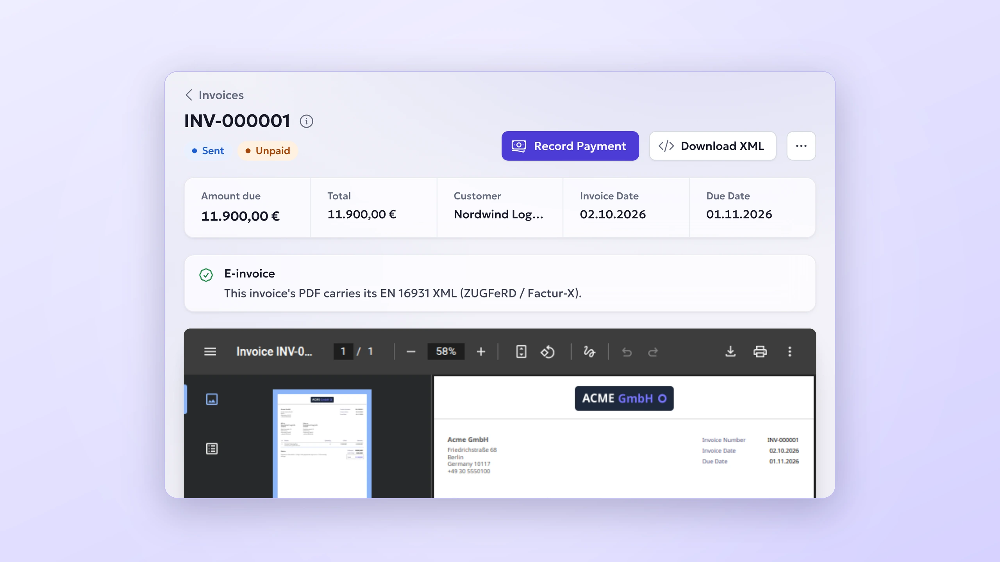

# InvoiceShelf E-Invoicing module



EN 16931 e-invoices for InvoiceShelf 3. With the module enabled, an invoice PDF becomes a **ZUGFeRD / Factur-X hybrid e-invoice**: a PDF/A-3b file that people read and accounting software reads too, through the EN 16931 XML embedded in it as `factur-x.xml`. The same XML can be downloaded on its own from every invoice.

- **Settings** (company settings, owners only): switch e-invoicing on, the IBAN and BIC the e-invoice asks to be paid to, and payment terms. A checklist shows what the company details still lack.
- **On every invoice**: a panel says whether its PDF carries the XML and, if not, exactly what is missing; a **Download XML** action gets the XML.
- **Every delivery path**: download, public link, customer portal, mail attachment and archive all carry the same XML, because the host embeds it wherever it renders an invoice PDF.
- **Never in the way**: an invoice that does not meet the requirements, a PDF service that cannot embed, or any failure here gives the ordinary PDF. Billing never waits on an e-invoice.

Source and compiled assets are licensed `AGPL-3.0-only`.

## What it covers

| Where | What this version gives you |
| --- | --- |
| Germany (B2B) | A compliant e-invoice: ZUGFeRD in the EN 16931 profile, sent the way you already send invoices. |
| France | Factur-X EN 16931, one of the three formats the reform accepts. Transmission through a certified platform (Plateforme Agréée) is not part of this module. |
| Elsewhere | A valid EN 16931 e-invoice any recipient may accept voluntarily, and the XML for portals that take a file upload. |

Not yet: UBL (Peppol BIS Billing 3.0, XRechnung UBL), sending through Peppol or a platform, and national clearance formats (Italy, Poland, Greece). The module builds an EN 16931 document first and writes CII from it, so a UBL writer is an addition rather than a rewrite.

## Requirements

| Dependency | Constraint |
| --- | --- |
| InvoiceShelf | `>=3.0.0-alpha.13 <4.0.0` |
| Module API | `^1.5.0` (invoice documents and invoice PDF attachments) |
| PHP | `^8.4.0` with `dom`, `fileinfo`, `gd`, `iconv`, `json`, `libxml`, `mbstring`, `simplexml`, `zip`, `zlib` |
| PDF rendering | The **Gotenberg** driver, **8.34 or newer**, as the full image (`gotenberg/gotenberg:8.37.0`, not `-chromium`, which cannot convert to PDF/A). With dompdf the XML download still works; PDFs stay ordinary. |

### What an invoice needs

Company: name, street, post code, city, country and VAT ID (a national tax number alone does not identify the seller under EN 16931), plus an IBAN in the settings. Each invoice: a customer with a billing country, line items with names, net prices, one tax per line, a tax category code on every tax type (set in Tax Types; existing ones start as *Standard rate*, so set zero-rated and exempt ones accordingly, with their exemption reason), and a due date or payment terms. Reverse charge and intra-community supplies need the customer's VAT ID, with its country prefix, in the customer's tax ID. The invoice panel names whatever is missing.

## Local development

You need PHP 8.4, Composer, Node 24, pnpm 11, Java 21 for the conformance checks, and an InvoiceShelf 3.x checkout.

1. **Put the module where the host looks.** Clone it into the host's `Modules/EInvoicing`, or keep it as a sibling checkout and link it: `ln -s ../../module-e-invoicing InvoiceShelf/Modules/EInvoicing` (in the devenv, the sibling directory is also bind-mounted into the PHP container).
2. **Install the module's tools**: `composer install` and `pnpm install`.
3. **Build the bundle** against the host you run: `vendor/bin/invoiceshelf-module bundle . --host-lock=../InvoiceShelf/composer.lock`.
4. **Build the frontend**: `pnpm run build` writes `dist/init.js` and `dist/style.css`. There is no hot reload.
5. **Install it into the host**: `php artisan install:module EInvoicing 0.1.0`, then pick the Gotenberg driver in Administration → PDF Generation (a sidecar on a private address must be named in `GOTENBERG_ALLOWED_PRIVATE_HOST`).
6. **Open** Settings → E-Invoicing, then any invoice.

The tests run without a host, on Orchestra Testbench with the host's contracts faked: `composer run test`. They include the builder tests André Kinne and iebl wrote, ported onto the host's document data. The business rules are checked separately, against Mustang CLI and the CEN EN 16931 schematron:

```bash
MUSTANG_JAR=/path/to/Mustang-CLI-2.25.0.jar vendor/bin/phpunit --group schematron
```

`tests/Fixtures/invoice-document.standard.json` is a copy of the host's worked example (`InvoiceShelf/tests/Fixtures/modules/invoice-document.standard.json`), and CI fails when the two differ.

## Dependencies

The module is `bundled`: [horstoeko/zugferd](https://github.com/horstoeko/zugferd) and the packages it needs that InvoiceShelf does not ship are built into `bundle/` from the committed `bundle.lock`, and signed with each release. Update them with `composer update horstoeko/zugferd` followed by `vendor/bin/invoiceshelf-module bundle . --host-lock=<host composer.lock> --update`, and review the `bundle.lock` diff like code. The SDK README's "Dependencies" section has the rules.

## Data

Settings live in the host's company settings under `module.e-invoicing.*`. The module has no tables. Uninstalling with **Remove module data** deletes those settings for every company.

## Credits

The EN 16931 mapping, its requirements and their tests come from the ZUGFeRD work André Kinne ([0xShinRai](https://github.com/0xShinRai)) and [iebl](https://github.com/iebl) built for InvoiceShelf; this module carries it onto the module system, with credit notes, payment terms, reverse charge and intra-community supplies added.

## Releases

Push a tag equal to `module.json`'s `version` (unprefixed, such as `0.1.0`). The tag workflow uses the SDK's reusable workflow to validate, bundle against the oldest supported InvoiceShelf release, package, sign and register the release with the marketplace. See [CONTRIBUTING.md](CONTRIBUTING.md).
